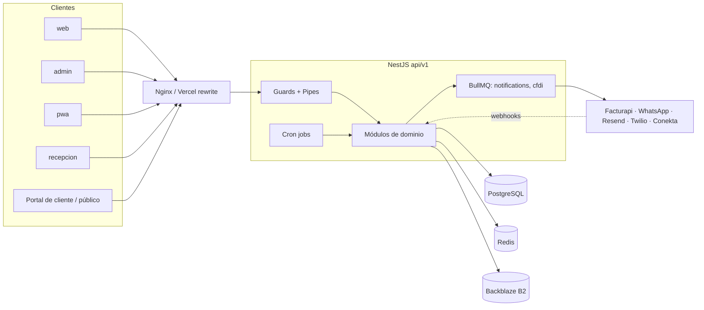
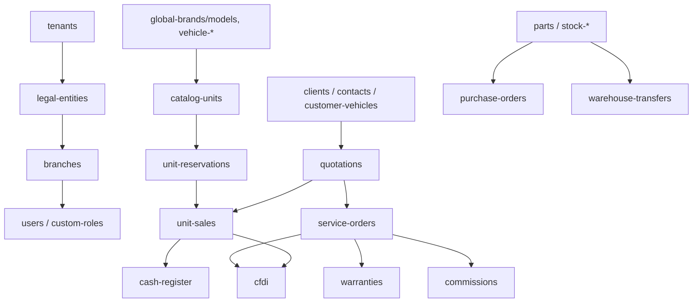

# Arquitectura

Complementa `docs/ARCHITECTURE.md` (que describe la visión de diseño). Aquí se recoge lo verificado en el código de `main`.

## Componentes

| Componente | Ruta | Descripción |
|------------|------|-------------|
| API | `apps/api` | NestJS monolito modular, prefijo `api/v1`, ~85 módulos de dominio |
| Web | `apps/web` | Angular, aplicación principal de operadores |
| Admin | `apps/admin` | Angular, superadministración de la plataforma (tenants, planes SaaS) |
| PWA | `apps/pwa` | Angular PWA (mecánico) |
| Recepción | `apps/recepcion` | Angular, portal del recepcionista de taller |
| Landing | `apps/landing` | Sitio estático (`index.html`) con `vercel.json` |
| Nginx | `nginx/` | Reverse proxy dev (`*.localhost`) y prod (TLS, `*.nexdms.com`) |
| Scripts | `scripts/` | `init.sql`, `migrate.sh`, `backup.sh`, `validate-implementation.sh` |

## Capas de la API

1. Arranque (`src/main.ts`): Helmet, protección CSRF por doble cookie (solo si la sesión es por cookie y no hay Bearer), CORS restringido (`CORS_ORIGINS`; en producción cae a una lista de dominios por defecto), `HttpExceptionFilter`, `ClassSerializerInterceptor`, `ValidationPipe` (`whitelist`, `forbidNonWhitelisted`, `transform`), Swagger fuera de producción.
2. Guards (`src/common/guards`): `auth.guard`, `roles.guard`, `scope.guard`, `platform-admin.guard`, `idempotency.guard`; throttling con almacenamiento en Redis (`common/throttler`).
3. Módulos de dominio (`src/modules/*`): controlador + servicio + entidades + DTOs por módulo.
4. Transversal (`src/common`): auditoría, billing, correo (`email`, `document-mail`), PDF, storage (B2), redis, idempotencia, tenancy.
5. Eventos y colas: `src/events` (EventEmitter) y `src/queues` (BullMQ; colas `notifications` y `cfdi`).
6. Tareas programadas: `src/modules/cron/jobs`.
7. Persistencia: TypeORM sobre PostgreSQL; migraciones en `src/database/migrations` (137 archivos), seeds en `src/database/seeds`.

## Multi-tenancy y roles

Jerarquía: tenant > razón social (`legal-entities`) > sucursal (`branches`) > usuarios (tabla `user_branches`). Roles (`RoleEnum`): SUPERADMIN, ADMIN, MANAGER, WAREHOUSE, CASHIER, MECHANIC, RECEPTIONIST, SELLER, EXECUTIVE, LEGAL_ENTITY_MANAGER, además de roles personalizados (`custom-roles`, `role-map`). La administración de plataforma tiene su propio flujo de autenticación (`admin-auth`) y auditoría (`superadmin-audit`).

> Por confirmar: el mecanismo exacto de aislamiento por tenant (columna `tenant_id`, filtros en servicios, etc.) y el uso de JWT RS256 que menciona `docs/ARCHITECTURE.md`; el código revisado usa `JWT_SECRET`.

## Dependencias externas

| Servicio | Uso | Evidencia |
|----------|-----|-----------|
| PostgreSQL | BD principal | `DATABASE_URL`, `database.config.ts` |
| Redis | Colas, throttling, refresh token | `REDIS_URL`; `render.yaml` lo marca como dependencia dura del login |
| Backblaze B2 | Archivos | `b2.config.ts`, `common/storage` |
| Resend | Correo | `RESEND_API_KEY` |
| EmailJS | Correo (variables presentes) | `EMAILJS_*` |
| Twilio | SMS | `TWILIO_*` |
| Facturapi | CFDI | `modules/cfdi/cfdi-facturapi.client.ts` |
| WhatsApp Cloud API | Bot y notificaciones | `modules/whatsapp-bot`, `WHATSAPP_*` |
| Conekta | Cobro SaaS | `modules/saas/conekta.service.ts`, `CONEKTA_PRIVATE_KEY` |

## Diagrama de componentes

## Diagrama de dominios

> Por confirmar: las relaciones del diagrama de dominios son una simplificación basada en nombres de módulo y en los documentos `docs/modules/*`; no se verificó cada relación entre entidades.
