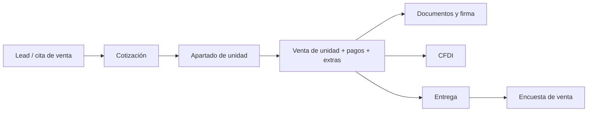
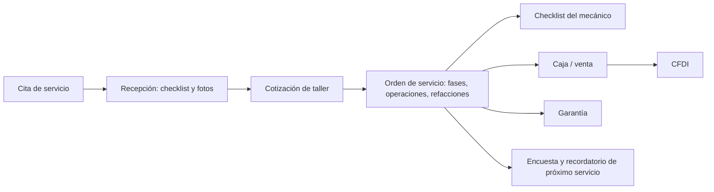

# Workflows, CI/CD y despliegue

## Flujos de negocio principales

Basado en los módulos y controladores existentes (detalle funcional en `docs/modules/*` y los `PLAN_*.md`).





Otros flujos: compras (requisiciones, órdenes de compra, devoluciones de partes), almacén (transferencias, conteos, movimientos), caja (sesiones y movimientos), comisiones por periodo, PLD (`pld`), flotillas (`fleets`), hojalatería (`bodywork`), seminuevos (`used-units`), portal de cliente y bot de WhatsApp.

> Por confirmar: el orden exacto y los estados de cada flujo; los diagramas se infieren de nombres de módulos y documentos de plan.

## Trabajos programados (`src/modules/cron/jobs`)

`appointment-no-show`, `appointment-reminders`, `data-retention`, `payment-overdue`, `saas-overdue-summary`, `service-due-reminders`, `shop-daily-summary`, `stock-minimum`.

> Por confirmar: horarios de ejecución de cada job y su configuración.

## Colas

BullMQ con dos colas registradas: `notifications` y `cfdi` (`src/queues/queues.module.ts`).

## Webhooks entrantes

`saas/webhook` (cobro SaaS), `whatsapp` (bot/verificación), rutas `public/*` (firmas y encuestas públicas).

## CI/CD

- No existe carpeta `.github/` en `main`: no hay workflows de GitHub Actions versionados, aunque el README raíz y `docs/ARCHITECTURE.md` mencionan GitHub Actions y "deploy al hacer push a main". Por confirmar: dónde vive ese pipeline (otro repo, configuración en Render/Vercel, o no implementado).
- Validación manual: `npm run validate` ejecuta `scripts/validate-implementation.sh` (build de API, migraciones, tests e2e seleccionados).
- Pruebas: Jest unitarias (`*.spec.ts`) y e2e en `apps/api/test`.

## Build de imágenes

Cada app tiene un `Dockerfile` multi-stage:

- `apps/api`: `base` (npm ci), `development` (start:dev, puertos 3000 y 9229), `builder` (nest build) y `production` (node:20-alpine, usuario no root, `node dist/main`).
- `apps/web|admin|pwa|recepcion`: `development` (ng serve), `builder` (build de producción) y `production` (nginx:alpine sirviendo `dist/browser` con su `nginx.conf`).

## Despliegue

1. **Docker Compose local** (`docker-compose.yml`): Postgres 18, Redis 7, api, web, pwa, admin, recepcion y nginx (configuración dev en `nginx/nginx.dev.conf`, hosts `*.localhost`).
2. **VPS** (`docker-compose.prod.yml` + `nginx/nginx.prod.conf`): Postgres 15, Redis 7, TLS en Nginx, dominios `*.nexdms.com`. Backup diario con `scripts/backup.sh` (pg_dump comprimido, envío a Backblaze B2 y aviso por correo si falla). Pasos de setup del VPS en el README raíz. Por confirmar: si este esquema sigue vigente (el compose prod declara Postgres 15 y el nginx prod visible no define upstream para `recepcion`).
3. **Render** (`render.yaml`, Blueprint): BD Postgres, Redis y web service `nexdms-api` (`rootDir: apps/api`). El `startCommand` ejecuta migraciones pendientes y luego `npm run start:prod`; health check en `/api/v1/health`. Node fijado a 22.
4. **Vercel**: `vercel.json` raíz construye `apps/web` y reescribe `/api/*` hacia el API en Render; cada app tiene además su propio `vercel.json`.

## Migraciones

```bash
cd apps/api
npm run build
npm run migration:run        # aplica pendientes
npm run migration:revert     # revierte la última
npm run migration:generate -- src/database/migrations/Nombre
```

Existe también `scripts/migrate.sh` (Por confirmar su uso actual).

## Seeds

En `apps/api`: `npm run seed`, `seed:operativo`, `seed:file`, `seed:mechanic-checklist`.
